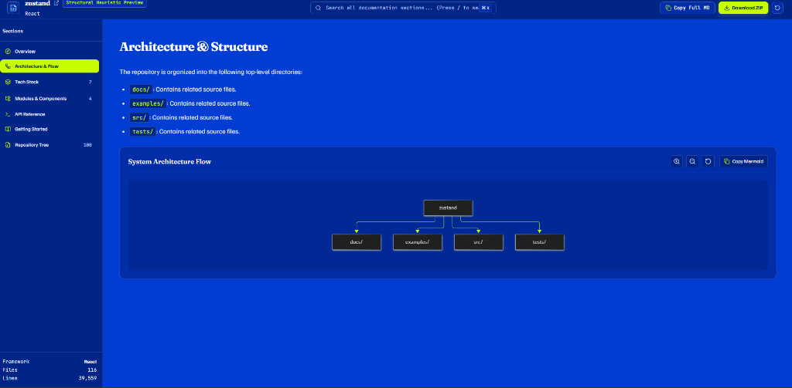
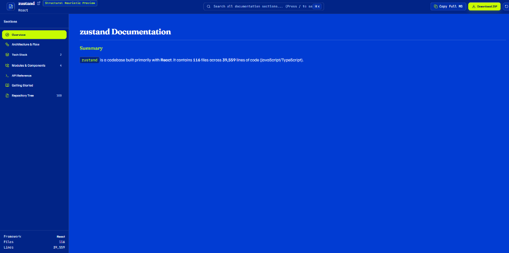
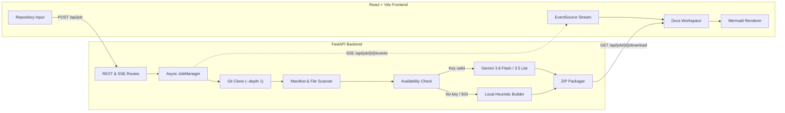

<div align="center">


# Auto-Documenter

Static AST topology, Mermaid architecture diagrams, and Markdown documentation generator for public GitHub repositories.

[](https://www.python.org/)
[](https://fastapi.tiangolo.com/)
[](https://react.dev/)
[](https://vitejs.dev/)
[](https://mermaid.js.org/)
[](LICENSE)

[Overview](#overview) | [Screenshots](#screenshots) | [Architecture](#architecture) | [Setup](#setup) | [API](#api)

</div>

---

## Overview

Auto-Documenter clones a public GitHub repository, scans its directory tree and package manifests, and builds a browsable documentation workspace. It works out of the box using local static analysis and optionally connects to the Google GenAI SDK when an API key is provided for deeper module and endpoint writeups.

### Features

- **Offline Structural Mode**: Runs locally without an API key to index file trees, count lines by language, inspect dependency manifests (`package.json`, `requirements.txt`, `pyproject.toml`, `go.mod`, `Cargo.toml`), and build a top-level Mermaid architecture diagram.
- **Full-Depth Synthesis Mode**: Uses `gemini-3.8-flash` (falling back to `gemini-3.5-flash-lite` on `503` or `429` responses) to document module responsibilities, key files, and public interfaces.
- **Interactive Mermaid Viewer**: Renders pan-and-zoom `graph TD` flowcharts in the workspace with a button to copy the raw Mermaid source.
- **7-Section Workspace**: Splits output into Overview, Architecture & Flow, Tech Stack, Modules & Components, API Reference, Getting Started, and Repository Tree.
- **Quick Search**: Filters modules, tech stack entries, and repository files from the header search bar (`/` or `Ctrl+K`).
- **Live Progress Stream**: Streams job stages (`CLONING`, `ANALYZING`, `SYNTHESIZING`, `PACKAGING`, `COMPLETED`) over Server-Sent Events (SSE).
- **ZIP Export**: Packages `README.md`, `ARCHITECTURE.md`, `API_REFERENCE.md`, `GETTING_STARTED.md`, and `docs.json` into a downloadable `.zip` archive.

---

## Screenshots

### Landing Page
<p align="center">
  
</p>

### Documentation Workspace & Architecture Flow
| Project Overview | Architecture & Mermaid Flow |
| :---: | :---: |
|  |  |

---

## Architecture



### Job Pipeline

1. **Clone (`15%`)**: Runs `git clone --depth 1` into an isolated job directory and ignores binary files, lockfiles, and build folders (`node_modules`, `.venv`, `dist`, `target`).
2. **Analyze (`35%`)**: Counts files and lines per language, parses root manifest files to detect the primary framework, and extracts entrypoints and route files.
3. **Synthesize (`65%`)**:
   - Checks key and model availability before running a full generation job.
   - Retries with `gemini-3.5-flash-lite` if `gemini-3.8-flash` returns `503 UNAVAILABLE` or `429 RESOURCE_EXHAUSTED`.
   - Uses the local structural builder when no key is configured or when remote endpoints are unreachable.
4. **Package (`85%` to `100%`)**: Writes the Markdown files and `docs.json` to disk, creates `{job_id}_docs.zip`, and removes the cloned repository folder.

---

## Project Layout

```text
Auto-Documenter/
├── backend/
│   ├── engine/
│   │   ├── analyzer.py        # Shallow git clone, file scanner, framework detection
│   │   ├── generator.py       # Availability check, model fallback, heuristic builder
│   │   └── models.py          # Pydantic schemas for documentation payloads
│   ├── tasks/
│   │   └── manager.py         # Async job runner, SSE broadcaster, ZIP packager
│   ├── config.py              # Environment settings
│   ├── main.py                # FastAPI app and route handlers
│   ├── Dockerfile
│   └── requirements.txt
├── frontend/
│   ├── public/
│   │   └── favicon.svg
│   ├── src/
│   │   ├── components/
│   │   │   ├── common/        # Logo, background canvas, status banner
│   │   │   ├── landing/       # URL form, workflow steps, feature grid, usage guide
│   │   │   ├── progress/      # Progress indicator and stage stepper
│   │   │   └── workspace/     # Workspace layout, header, sidebar, search, viewers
│   │   ├── styles/
│   │   │   └── tokens.css     # Color and font variables
│   │   ├── App.jsx
│   │   ├── index.css
│   │   └── main.jsx
│   ├── Dockerfile
│   ├── index.html
│   ├── package.json
│   ├── postcss.config.js
│   ├── tailwind.config.js
│   └── vite.config.js
├── docs/
│   └── assets/                # Screenshots used in README
├── .env.example
├── .gitignore
├── docker-compose.yml
├── LICENSE
├── README.md
└── requirements.txt
```

---

## Setup

### Requirements

- Python `3.11+` and `git` on `PATH`
- Node.js `18+` and `npm`
- Optional: Gemini API key from [Google AI Studio](https://aistudio.google.com/)

### 1. Environment Variables

Copy `.env.example` to `.env` in the root directory:

```bash
cp .env.example .env
```

```env
# Leave as placeholder for offline heuristic mode, or enter a key in the web UI.
GEMINI_API_KEY=placeholder
GEMINI_MODEL=gemini-3.8-flash

# Optional S3 upload (uses direct local ZIP download when set to placeholder)
AWS_ACCESS_KEY_ID=placeholder
AWS_SECRET_ACCESS_KEY=placeholder
AWS_REGION=us-east-1
S3_BUCKET_NAME=auto-documenter-bundles
```

### 2. Local Development

**Backend (`http://localhost:8000`):**

```bash
cd backend
python -m venv .venv

# Windows (PowerShell):
.\.venv\Scripts\Activate.ps1
# macOS / Linux:
source .venv/bin/activate

pip install -r requirements.txt
uvicorn main:app --reload --host 0.0.0.0 --port 8000
```

**Frontend (`http://localhost:5173`):**

```bash
cd frontend
npm install
npm run dev
```

### 3. Docker Compose

```bash
docker compose up --build
```

- Frontend: `http://localhost:5173`
- Backend API: `http://localhost:8000`
- OpenAPI docs: `http://localhost:8000/docs`

---

## API

| Method | Path | Description |
| :--- | :--- | :--- |
| `GET` | `/api/health` | Service status and active configuration flags |
| `POST` | `/api/gemini/validate` | Checks whether a Gemini API key and model are reachable |
| `POST` | `/api/job` | Starts a documentation job (`repo_url`, `depth`, `api_key`) |
| `GET` | `/api/job/{job_id}` | Returns current job state and generated documentation |
| `GET` | `/api/job/{job_id}/events` | SSE stream emitting progress updates until completion |
| `GET` | `/api/job/{job_id}/download` | Downloads `{job_id}_documentation.zip` |

---

## License

[MIT](LICENSE)
